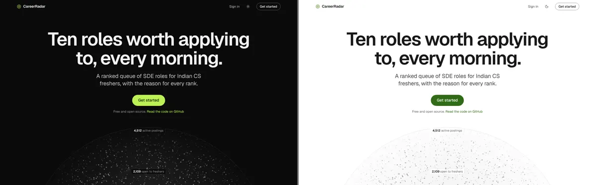
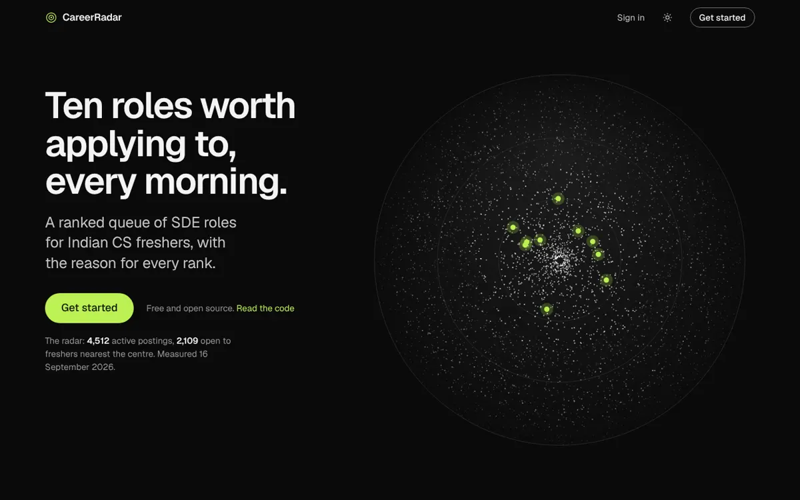
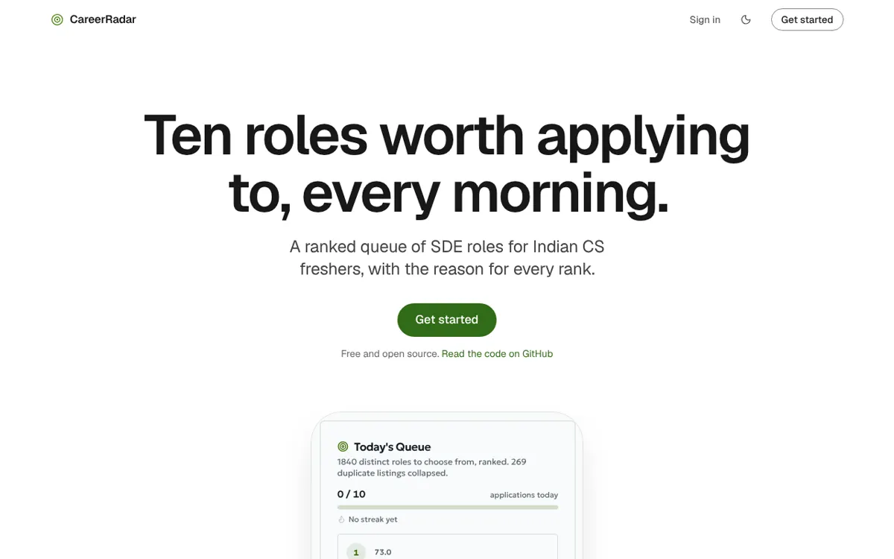
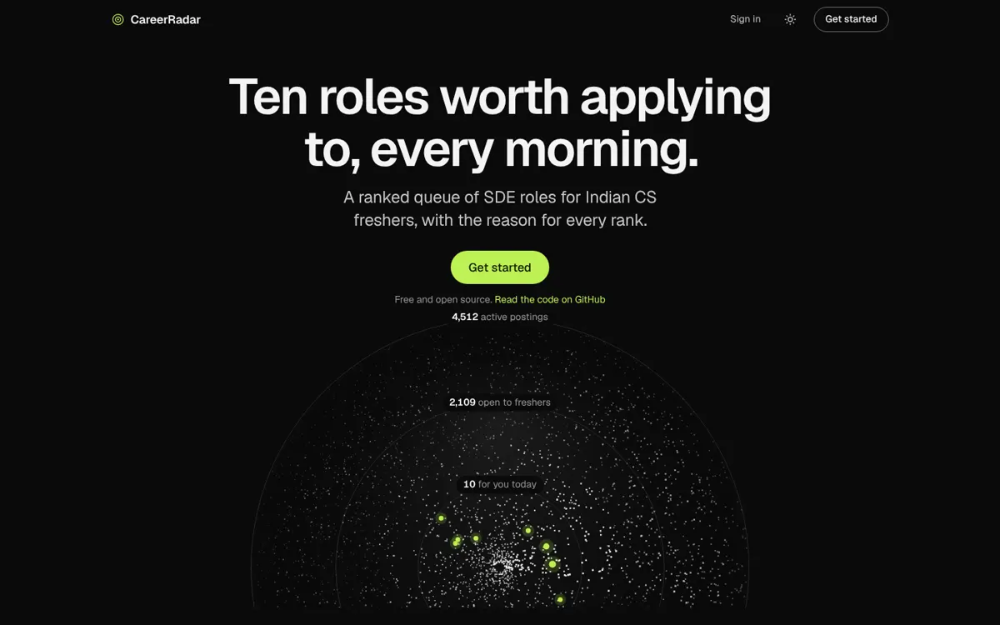
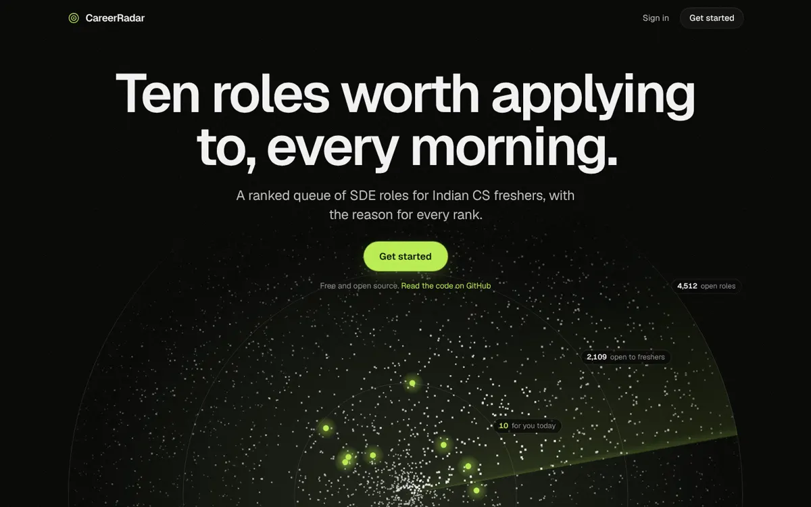
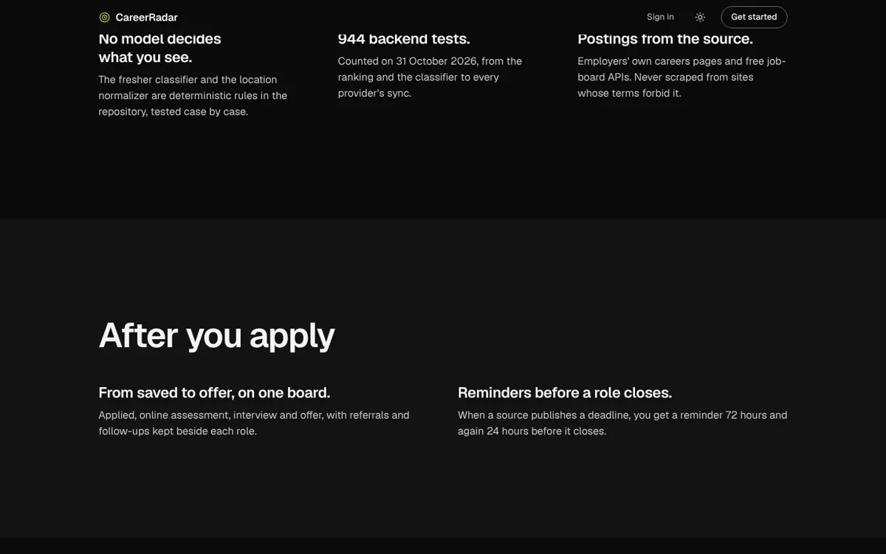
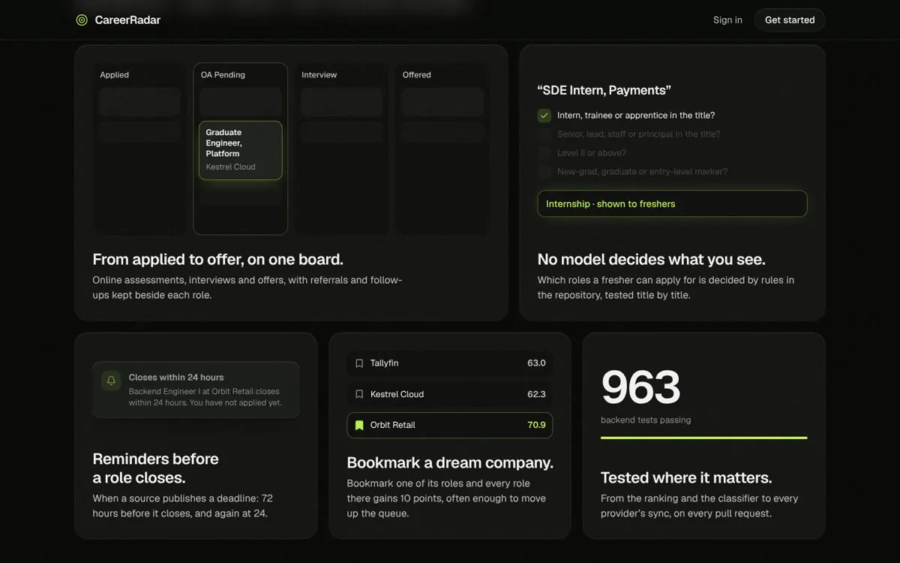

# CareerRadar, a case study

CareerRadar ranks the ten SDE roles an Indian computer-science fresher should apply to each morning, and says why each one ranks where it does. I designed and built it end to end: the ranking rules, the data pipeline, the app and the landing page.

This file lives in the repository only. It replaces the `/design-notes` page, which was removed from the site in the "Field to focus" landing (2026-11-03, `docs/LANDING_V3.md`). Engine detail that used to sit on the landing page (test counts, "no model decides what you see", where postings may not come from) is kept here instead.

| | |
|---|---|
| Role | Product design, frontend and backend, solo |
| Timeline | July to November 2026 (first commit 2026-07-07) |
| Stack | React 18, Vite, Express 5, PostgreSQL with Drizzle, Clerk, framer-motion |
| Links | [Live app](https://careerradar-34ec.onrender.com) · [Source](https://github.com/UditSinghChauhan/CareerRadar) |

## Problem and users

- **The student.** A final-year computer-science student, or a recent graduate, looking for SDE roles in India. Their job is to apply to the right roles each day without scrolling every board. Most postings are not open to a fresher, and the ones that are look alike in a feed.
- **The visitor.** A recruiter or hiring engineer who gives the landing page under a minute. They succeed when they understand what the product does and then open the app or the code.

## Constraints

- **No scraping where terms forbid it.** No scrapers for LinkedIn, Naukri, Internshala, Unstop or Wellfound. Postings come from employers' own ATS boards (Greenhouse, Lever, Ashby, SmartRecruiters, Workday) and free job-board APIs (RemoteOK, Remotive, Jobicy, Adzuna, JSearch); a bookmarklet captures anything else from a tab the user already has open. The landing page used to say "never scraped"; it now lists the sources only.
- **No model decides what a student sees.** The fresher classifier and the location normalizer are deterministic rules, tested title by title. A language model is optional (match scores and parsing a pasted description) and never classifies. The landing page's FAQ answers "Does an AI pick my roles?" in one line; the detail lives here.
- **Deadlines are rare.** Sources seldom publish one, so the 30%-weighted deadline term scores almost every row the same (3.0). The app says so once, in the queue's "How is this ranked?" note, instead of on every row.
- **Explainable ranking.** Every score has four weighted parts: fit (relevance) 40%, closing soon (deadline) 30%, freshness 20%, dream company 10% (`artifacts/api-server/src/queue/priority.ts`). Each row shows up to three short reasons built from the same data.
- **Free hosting.** One Render instance serves the API and the app, so the landing must paint without waiting for anything slow.

## How the landing page evolved

1. **Vantage** (2026-10-31, superseded): Geologica, dark only, no scroll reveals.
2. **Neutral** (2026-10-31, superseded): three concept mockups and a synthesis. Each concept had a gap: A explained nothing after its hero, B opened on a split layout, and C had no signature moment. The synthesis took A's radar hero, B's walkthrough of the real queue and C's restraint. It shipped as an honest but flat page: its rules banned light, tiles and icons and put a date on every number, so after one strong moment it ran about 3,300px of text.

   
   
   

3. **"From 4,512 to ten"** (2026-11-01, superseded): one dark scroll story. The radar became the queue, the queue a card, the card an application, and the application landed on a board. It fixed the flatness but grew to about 12,200px at 1440, showed the radar full-size twice, put lime glow on everything and spoke in engine terms.

   
   
   
   

4. **"Field to focus"** (2026-11-03, current): a light, quiet page of seven sections, at most 6,500px at 1440. See `docs/LANDING_V3.md` and `DESIGN.md`.

## Motion principles (kept)

- Scroll is the timeline, never hijacked: native scroll only, no smooth-scroll library.
- Only transform and opacity animate on the light page; blur is a fixed property of each depth layer, never animated.
- Loops run only when seen, and stop off screen and in a hidden tab.
- Reduced motion shows the end state at once.

## Accessibility decisions

- A focus ring for the keyboard only (`:focus-visible`), so a mouse click never leaves a ring behind.
- Product demonstrations are `inert` and described in a sentence for screen readers; the radar canvas carries a label with the counts it draws.
- Live counts never show zero as news: an outage keeps the committed figures and hides the "Live" mark.
- Every pair of text and background passes WCAG AA (measured pairs are listed in `DESIGN.md`).

## How it is checked

The backend test suite runs on every pull request; the database-facing tests run against a real Postgres compiled to WebAssembly (PGlite). On 2026-11-03 `pnpm --filter @workspace/api-server test` reported 966 tests and `pnpm --filter @workspace/career-radar test` reported the frontend suite (counts in the PR that introduced this file). The landing page's sample queue is checked against the production scoring code by `artifacts/api-server/src/queue/illustrative-queue.test.ts`, so its scores and reasons cannot drift from the product.

The landing page no longer prints a test count: it is engine detail for a reader of the code, not for a first-time visitor.

## Next

- Get real deadlines into the data, so the 30% closing-soon part starts separating roles.
- Not yet measured: real-user usage and retention. There are no users to report, so this file reports none.
